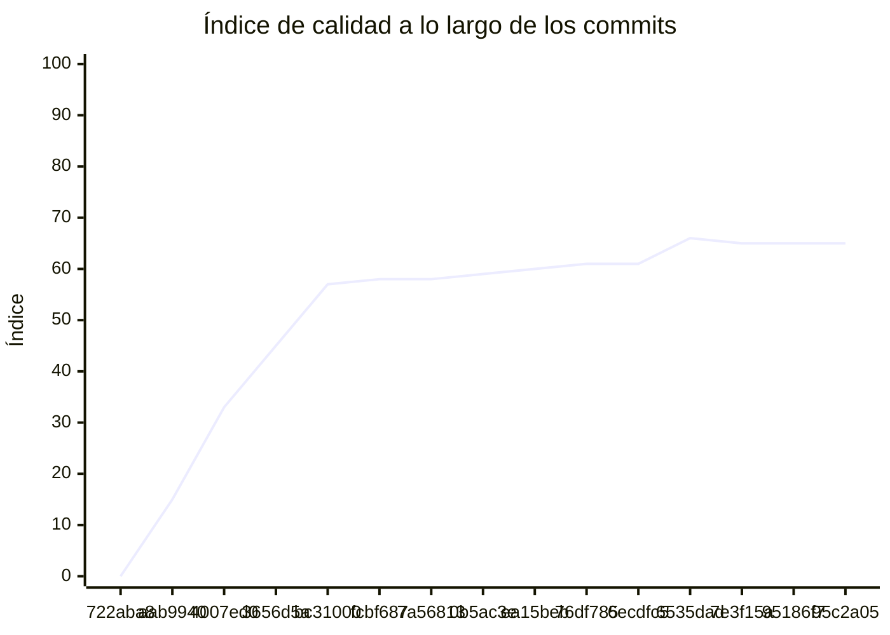

<!-- evaluacion:inicio -->
# Evaluación — prog2-portal-rocio/svc-turnos

> Documento **generado automáticamente** por la cátedra de Programación II (UM): RepoSense + análisis de calidad de **7 dimensiones**. **No editar a mano**: se regenera en cada evaluación.
> Rama evaluada: `main`. Análisis **heurístico** (regex + métricas) + build: es una criba para orientar la revisión, **no una nota**. La **documentación** del repositorio no se evalúa.
> Generado: 2026-11-20.

## 1. Veredicto

| Aspecto | Resultado |
|---|---|
| Índice de calidad | **76/100** |
| Tipo de repositorio | `backend` |
| Build (`mvnw verify` / `gradlew check`) | OK |
| Código (LOC) | 8,396 |
| Archivos de código | 175 |
| Clases | 196 |
| Código dentro de clases (%POO) | 78% |
| Funciones fuera de clases | 0 |
| Duplicación (puerta) | 2.3% |
| Duplicación lógica | 2.4% |
| Duplicación de boilerplate | 3.7% |
| Cobertura | 97% |
| Tope duro aplicado a D1 | `POO_BAJO` → D1 ≤ 60 |

> Este informe **describe** lo que el análisis midió con los criterios ya establecidos de la materia. No es una nota.

## 2. Semáforo de aprobación

Criterios de la cátedra (`CRITERIOS-CALIDAD.md`): **Aprobar** se juega con el perfil `estandar`; **destacar**, con el `exigente` (meta de excelencia).

| Semáforo | Resultado |
|---|---|
| Aprobar (`estandar`) | **no cumple** — 7/11 |
| Destacar (`exigente`) | **no cumple** — 5/11 |

**Para aprobar, falta cumplir:** SOLID

**Para destacar, falta cumplir:** SOLID; POO; Duplicación

## 3. Autoría (RepoSense)

| Autor | Commits | Código (LOC) | Tests (LOC) | Docs (LOC) | Días activos | % del código |
|---|---:|---:|---:|---:|---:|---:|
| Pilar Rocío Portal Romano | 1 | 0 | 0 | 1 | 11 | 0% |

> _El LOC de autoría lo calcula RepoSense sobre el historial y puede diferir del LOC de código del análisis (que mira el estado de `main`)._

## 4. Dimensiones evaluadas

Cada dimensión indica **qué mide**, **por qué importa** y **tu resultado**. Cuando el puntaje queda por debajo de la referencia, se agregan preguntas para **investigar la causa** (no hay recetas).

| Dimensión | Peso | Puntaje |
|:--|--:|--:|
| **D1** Diseño OO, SOLID y patrones (20%) | 20% | 2 |
| **D2** Arquitectura hexagonal — backend (15%) | 15% | 100 |
| **D3** Frontend KMP: MVVM y buenas prácticas (10%) | 10% | N/A |
| **D4** Integración y contrato (10%) | 10% | 80 |
| **D5** Seguridad y robustez (10%) | 10% | 100 |
| **D6** Pruebas y cobertura (20%) | 20% | 100 |
| **D7** Proceso y entrega (15%) | 15% | 100 |

### D1. Diseño OO, SOLID y patrones (20%)

- **Qué mide:** Métricas orientadas a objetos (clases, métodos, campos, cohesión, acoplamiento, herencia) y proxies de SOLID, más patrones de diseño.
- **Por qué importa:** El eje de la materia es el buen uso de la POO y su arquitectura: un diseño con clases claras y poco acopladas es más fácil de entender, probar y cambiar.
- **Tu resultado:** **2/100**
- **Para investigar la causa:**
    - ¿Se pensó el modelo de clases antes de codificar o se agrupó después?
    - ¿Qué clases concentran muchas responsabilidades a la vez?
    - ¿Los colaboradores llegan como parámetros o se crean por dentro?

### D2. Arquitectura hexagonal — backend (15%)

- **Qué mide:** Separación en capas (dominio, puertos de entrada/salida, adaptadores) y dirección de las dependencias del backend.
- **Por qué importa:** Aislar el dominio de la infraestructura permite cambiar la base de datos, el framework o el transporte sin tocar las reglas de negocio.
- **Tu resultado:** **100/100**

### D4. Integración y contrato (10%)

- **Qué mide:** Cumplimiento del contrato de integración de la cátedra (formato de errores, paginación, autenticación, endpoints esperados).
- **Por qué importa:** Los servicios deben poder integrarse entre sí y con la app sin sorpresas; el contrato es lo que hacen cumplir las pruebas de integración.
- **Tu resultado:** **80/100**

### D5. Seguridad y robustez (10%)

- **Qué mide:** Credenciales embebidas, consultas SQL por concatenación, y presencia de config de entorno; aislamiento de secretos.
- **Por qué importa:** Un secreto en el repositorio o una consulta construida por concatenación son riesgos concretos, no hipotéticos.
- **Tu resultado:** **100/100**

### D6. Pruebas y cobertura (20%)

- **Qué mide:** Cantidad y resultado de pruebas y cobertura de línea (JaCoCo/Kover, Surefire/Failsafe) cuando hay build.
- **Por qué importa:** Las pruebas son la red de seguridad para refactorizar e integrar; la cobertura acota las zonas sin verificar.
- **Tu resultado:** **100/100**

### D7. Proceso y entrega (15%)

- **Qué mide:** Artefactos verificables de proceso/entrega: `compose`, `.env.example`, CI (`.github/workflows/`), `CODEOWNERS` y wrapper de build (`mvnw`/`gradlew`). **No** puntúa documentación.
- **Por qué importa:** Un proyecto que compila, se levanta y se valida solo es más fácil de revisar y de integrar en equipo.
- **Tu resultado:** **100/100**

## 5. Señales detectadas

El análisis encontró las siguientes señales, con el archivo y la línea donde se originan cuando están disponibles:

**Archivos con más señales**

| Archivo | Señales |
|---|---:|
| `src/main/java/com/example/svcturnos/reserva/infrastructure/persistence/adapter/OutboxInformacionPersistenceAdapter.java` | 9 |
| `src/main/java/com/example/svcturnos/reserva/domain/model/ProcesoReserva.java` | 7 |
| `src/main/java/com/example/svcturnos/usuario/application/service/RegistrarUsuarioService.java` | 6 |
| `src/main/java/com/example/svcturnos/disponibilidad/infrastructure/client/OcupacionesRestClientAdapter.java` | 5 |
| `src/main/java/com/example/svcturnos/reserva/infrastructure/client/ConfirmarHoldRestAdapter.java` | 5 |
| `src/main/java/com/example/svcturnos/reserva/application/service/ConfirmarHoldService.java` | 5 |
| `src/main/java/com/example/svcturnos/catalogo/infrastructure/client/CatalogoRestClientAdapter.java` | 5 |
| `src/main/java/com/example/svcturnos/reserva/infrastructure/persistence/adapter/InboxReservasPersistenceAdapter.java` | 4 |
| `src/main/java/com/example/svcturnos/reserva/infrastructure/persistence/adapter/ProcesoReservaPersistenceAdapter.java` | 4 |
| `src/main/java/com/example/svcturnos/reserva/infrastructure/web/handler/HoldExceptionHandler.java` | 4 |

**DIP/concretos** (73)
- clase 'ConsultaCatalogoException' muy acoplada (CBO=12) — `src/main/java/com/example/svcturnos/catalogo/domain/exception/ConsultaCatalogoException.java:3`
- clase 'Motivo' muy acoplada (CBO=8) — `src/main/java/com/example/svcturnos/catalogo/domain/exception/ConsultaCatalogoException.java:5`
- clase 'CatalogoRestClientAdapter' muy acoplada (CBO=27) — `src/main/java/com/example/svcturnos/catalogo/infrastructure/client/CatalogoRestClientAdapter.java:25`
- clase 'CatalogoRestClientAdapter' instancia 6 concretos (CBO=27) — `src/main/java/com/example/svcturnos/catalogo/infrastructure/client/CatalogoRestClientAdapter.java:25`
- clase 'CatalogoRestClientConfiguration' muy acoplada (CBO=12) — `src/main/java/com/example/svcturnos/catalogo/infrastructure/client/CatalogoRestClientConfiguration.java:16`
- clase 'ConsultarDisponibilidadService' muy acoplada (CBO=15) — `src/main/java/com/example/svcturnos/disponibilidad/application/service/ConsultarDisponibilidadService.java:18`
- clase 'ConsultarDisponibilidadService' instancia 4 concretos (CBO=15) — `src/main/java/com/example/svcturnos/disponibilidad/application/service/ConsultarDisponibilidadService.java:18`
- clase 'ConsultaOcupacionesException' muy acoplada (CBO=13) — `src/main/java/com/example/svcturnos/disponibilidad/domain/exception/ConsultaOcupacionesException.java:3`
- clase 'Motivo' muy acoplada (CBO=9) — `src/main/java/com/example/svcturnos/disponibilidad/domain/exception/ConsultaOcupacionesException.java:4`
- clase 'AgendaDiaria' muy acoplada (CBO=10) — `src/main/java/com/example/svcturnos/disponibilidad/domain/model/AgendaDiaria.java:10`
- clase 'AgendaDiaria' instancia 4 concretos (CBO=10) — `src/main/java/com/example/svcturnos/disponibilidad/domain/model/AgendaDiaria.java:10`
- clase 'Ocupacion' muy acoplada (CBO=9) — `src/main/java/com/example/svcturnos/disponibilidad/domain/model/Ocupacion.java:8`
- clase 'OcupacionesResponseMapper' muy acoplada (CBO=8) — `src/main/java/com/example/svcturnos/disponibilidad/infrastructure/client/OcupacionesResponseMapper.java:12`
- clase 'OcupacionesResponseMapper' instancia 4 concretos (CBO=8) — `src/main/java/com/example/svcturnos/disponibilidad/infrastructure/client/OcupacionesResponseMapper.java:12`
- clase 'OcupacionesRestClientAdapter' muy acoplada (CBO=29) — `src/main/java/com/example/svcturnos/disponibilidad/infrastructure/client/OcupacionesRestClientAdapter.java:23`
- clase 'OcupacionesRestClientAdapter' instancia 7 concretos (CBO=29) — `src/main/java/com/example/svcturnos/disponibilidad/infrastructure/client/OcupacionesRestClientAdapter.java:23`
- clase 'OcupacionesRestClientConfiguration' muy acoplada (CBO=13) — `src/main/java/com/example/svcturnos/disponibilidad/infrastructure/client/OcupacionesRestClientConfiguration.java:15`
- clase 'ConfirmarHoldService' muy acoplada (CBO=43) — `src/main/java/com/example/svcturnos/reserva/application/service/ConfirmarHoldService.java:21`
- clase 'ConfirmarHoldService' instancia 12 concretos (CBO=43) — `src/main/java/com/example/svcturnos/reserva/application/service/ConfirmarHoldService.java:21`
- clase 'CrearHoldService' muy acoplada (CBO=22) — `src/main/java/com/example/svcturnos/reserva/application/service/CrearHoldService.java:17`
- clase 'CrearHoldService' instancia 5 concretos (CBO=22) — `src/main/java/com/example/svcturnos/reserva/application/service/CrearHoldService.java:17`
- clase 'EnviarInformacionService' muy acoplada (CBO=17) — `src/main/java/com/example/svcturnos/reserva/application/service/EnviarInformacionService.java:12`
- clase 'EnviarInformacionService' instancia 8 concretos (CBO=17) — `src/main/java/com/example/svcturnos/reserva/application/service/EnviarInformacionService.java:12`
- clase 'PublicarInformacionService' muy acoplada (CBO=8) — `src/main/java/com/example/svcturnos/reserva/application/service/PublicarInformacionService.java:11`
- clase 'RecibirEventoReservaService' muy acoplada (CBO=8) — `src/main/java/com/example/svcturnos/reserva/application/service/RecibirEventoReservaService.java:12`
- clase 'ConfirmarHoldException' muy acoplada (CBO=24) — `src/main/java/com/example/svcturnos/reserva/domain/exception/ConfirmarHoldException.java:3`
- clase 'Motivo' muy acoplada (CBO=12) — `src/main/java/com/example/svcturnos/reserva/domain/exception/ConfirmarHoldException.java:4`
- clase 'Codigo' muy acoplada (CBO=10) — `src/main/java/com/example/svcturnos/reserva/domain/exception/ConfirmarHoldException.java:9`
- clase 'CrearHoldException' muy acoplada (CBO=20) — `src/main/java/com/example/svcturnos/reserva/domain/exception/CrearHoldException.java:3`
- clase 'Motivo' muy acoplada (CBO=11) — `src/main/java/com/example/svcturnos/reserva/domain/exception/CrearHoldException.java:4`
- clase 'EnviarInformacionException' muy acoplada (CBO=12) — `src/main/java/com/example/svcturnos/reserva/domain/exception/EnviarInformacionException.java:3`
- clase 'Motivo' muy acoplada (CBO=10) — `src/main/java/com/example/svcturnos/reserva/domain/exception/EnviarInformacionException.java:4`
- clase 'EstadoEventoReserva' muy acoplada (CBO=8) — `src/main/java/com/example/svcturnos/reserva/domain/model/EstadoEventoReserva.java:4`
- clase 'EstadoProcesoReserva' muy acoplada (CBO=11) — `src/main/java/com/example/svcturnos/reserva/domain/model/EstadoProcesoReserva.java:4`
- clase 'EventoReserva' muy acoplada (CBO=14) — `src/main/java/com/example/svcturnos/reserva/domain/model/EventoReserva.java:6`
- clase 'EventoReserva' instancia 7 concretos (CBO=14) — `src/main/java/com/example/svcturnos/reserva/domain/model/EventoReserva.java:6`
- clase 'ProcesoReserva' muy acoplada (CBO=30) — `src/main/java/com/example/svcturnos/reserva/domain/model/ProcesoReserva.java:7`
- clase 'ProcesoReserva' instancia 16 concretos (CBO=30) — `src/main/java/com/example/svcturnos/reserva/domain/model/ProcesoReserva.java:7`
- clase 'SolicitudEnvioInformacion' muy acoplada (CBO=14) — `src/main/java/com/example/svcturnos/reserva/domain/model/SolicitudEnvioInformacion.java:7`
- clase 'SolicitudEnvioInformacion' instancia 5 concretos (CBO=14) — `src/main/java/com/example/svcturnos/reserva/domain/model/SolicitudEnvioInformacion.java:7`
- clase 'ConfirmarHoldRestAdapter' muy acoplada (CBO=37) — `src/main/java/com/example/svcturnos/reserva/infrastructure/client/ConfirmarHoldRestAdapter.java:22`
- clase 'ConfirmarHoldRestAdapter' instancia 9 concretos (CBO=37) — `src/main/java/com/example/svcturnos/reserva/infrastructure/client/ConfirmarHoldRestAdapter.java:22`
- clase 'CrearHoldRestAdapter' muy acoplada (CBO=25) — `src/main/java/com/example/svcturnos/reserva/infrastructure/client/CrearHoldRestAdapter.java:22`
- clase 'CrearHoldRestAdapter' instancia 9 concretos (CBO=25) — `src/main/java/com/example/svcturnos/reserva/infrastructure/client/CrearHoldRestAdapter.java:22`
- clase 'EventoReservaDecoder' muy acoplada (CBO=27) — `src/main/java/com/example/svcturnos/reserva/infrastructure/kafka/EventoReservaDecoder.java:18`
- clase 'EventoReservaDecoder' instancia 6 concretos (CBO=27) — `src/main/java/com/example/svcturnos/reserva/infrastructure/kafka/EventoReservaDecoder.java:18`
- clase 'InformacionKafkaProducerAdapter' muy acoplada (CBO=21) — `src/main/java/com/example/svcturnos/reserva/infrastructure/kafka/InformacionKafkaProducerAdapter.java:19`
- clase 'OutboxInformacionScheduler' muy acoplada (CBO=8) — `src/main/java/com/example/svcturnos/reserva/infrastructure/kafka/OutboxInformacionScheduler.java:17`
- clase 'ReservasKafkaConfiguration' muy acoplada (CBO=9) — `src/main/java/com/example/svcturnos/reserva/infrastructure/kafka/ReservasKafkaConfiguration.java:15`
- clase 'ReservasKafkaConsumerAdapter' muy acoplada (CBO=17) — `src/main/java/com/example/svcturnos/reserva/infrastructure/kafka/ReservasKafkaConsumerAdapter.java:17`
- clase 'InboxReservasPersistenceAdapter' muy acoplada (CBO=49) — `src/main/java/com/example/svcturnos/reserva/infrastructure/persistence/adapter/InboxReservasPersistenceAdapter.java:22`
- clase 'InboxReservasPersistenceAdapter' instancia 12 concretos (CBO=49) — `src/main/java/com/example/svcturnos/reserva/infrastructure/persistence/adapter/InboxReservasPersistenceAdapter.java:22`
- clase 'OutboxInformacionPersistenceAdapter' muy acoplada (CBO=53) — `src/main/java/com/example/svcturnos/reserva/infrastructure/persistence/adapter/OutboxInformacionPersistenceAdapter.java:16`
- clase 'OutboxInformacionPersistenceAdapter' instancia 6 concretos (CBO=53) — `src/main/java/com/example/svcturnos/reserva/infrastructure/persistence/adapter/OutboxInformacionPersistenceAdapter.java:16`
- clase 'ProcesoReservaPersistenceAdapter' muy acoplada (CBO=24) — `src/main/java/com/example/svcturnos/reserva/infrastructure/persistence/adapter/ProcesoReservaPersistenceAdapter.java:24`
- clase 'ProcesoReservaPersistenceAdapter' instancia 9 concretos (CBO=24) — `src/main/java/com/example/svcturnos/reserva/infrastructure/persistence/adapter/ProcesoReservaPersistenceAdapter.java:24`
- clase 'ProcesoReservaEntity' muy acoplada (CBO=8) — `src/main/java/com/example/svcturnos/reserva/infrastructure/persistence/entity/ProcesoReservaEntity.java:11`
- clase 'EventoInboxRowMapper' muy acoplada (CBO=10) — `src/main/java/com/example/svcturnos/reserva/infrastructure/persistence/mapper/EventoInboxRowMapper.java:10`
- clase 'EventoInboxRowMapper' instancia 3 concretos (CBO=10) — `src/main/java/com/example/svcturnos/reserva/infrastructure/persistence/mapper/EventoInboxRowMapper.java:10`
- clase 'UsuarioAutenticadoAdapter' muy acoplada (CBO=11) — `src/main/java/com/example/svcturnos/reserva/infrastructure/security/UsuarioAutenticadoAdapter.java:14`
- clase 'UsuarioAutenticadoAdapter' instancia 6 concretos (CBO=11) — `src/main/java/com/example/svcturnos/reserva/infrastructure/security/UsuarioAutenticadoAdapter.java:14`
- clase 'ConfirmacionHoldExceptionHandler' muy acoplada (CBO=26) — `src/main/java/com/example/svcturnos/reserva/infrastructure/web/handler/ConfirmacionHoldExceptionHandler.java:11`
- clase 'HoldExceptionHandler' muy acoplada (CBO=37) — `src/main/java/com/example/svcturnos/reserva/infrastructure/web/handler/HoldExceptionHandler.java:16`
- clase 'InformacionAdicionalExceptionHandler' muy acoplada (CBO=21) — `src/main/java/com/example/svcturnos/reserva/infrastructure/web/handler/InformacionAdicionalExceptionHandler.java:9`
- clase 'RegistrarUsuarioService' muy acoplada (CBO=14) — `src/main/java/com/example/svcturnos/usuario/application/service/RegistrarUsuarioService.java:15`
- clase 'RegistrarUsuarioService' instancia 6 concretos (CBO=14) — `src/main/java/com/example/svcturnos/usuario/application/service/RegistrarUsuarioService.java:15`
- clase 'UsuarioEntity' muy acoplada (CBO=8) — `src/main/java/com/example/svcturnos/usuario/infrastructure/persistence/entity/UsuarioEntity.java:18`
- clase 'JwtConfig' muy acoplada (CBO=36) — `src/main/java/com/example/svcturnos/usuario/infrastructure/security/JwtConfig.java:22`
- clase 'JwtConfig' instancia 3 concretos (CBO=36) — `src/main/java/com/example/svcturnos/usuario/infrastructure/security/JwtConfig.java:22`
- clase 'JwtTokenAdapter' muy acoplada (CBO=18) — `src/main/java/com/example/svcturnos/usuario/infrastructure/security/JwtTokenAdapter.java:14`
- clase 'SecurityConfig' muy acoplada (CBO=10) — `src/main/java/com/example/svcturnos/usuario/infrastructure/security/SecurityConfig.java:15`
- clase 'UsuarioController' muy acoplada (CBO=8) — `src/main/java/com/example/svcturnos/usuario/infrastructure/web/controller/UsuarioController.java:15`
- clase 'UsuarioExceptionHandler' muy acoplada (CBO=17) — `src/main/java/com/example/svcturnos/usuario/infrastructure/web/handler/UsuarioExceptionHandler.java:15`

**SRP/responsabilidad** (61)
- método 'Categoria.Categoria' con 6 parámetros — `src/main/java/com/example/svcturnos/catalogo/domain/model/Categoria.java:5`
- método 'HorarioSemanal.HorarioSemanal' con 9 parámetros — `src/main/java/com/example/svcturnos/catalogo/domain/model/HorarioSemanal.java:7`
- método 'Profesional.Profesional' con 8 parámetros — `src/main/java/com/example/svcturnos/catalogo/domain/model/Profesional.java:5`
- clase 'CatalogoRestClientAdapter' grande (LOC=66, métodos=11, campos=3) — `src/main/java/com/example/svcturnos/catalogo/infrastructure/client/CatalogoRestClientAdapter.java:25`
- clase 'CatalogoRestClientAdapter' con baja cohesión (7%) — `src/main/java/com/example/svcturnos/catalogo/infrastructure/client/CatalogoRestClientAdapter.java:25`
- método 'HorarioCatalogoResponse.HorarioCatalogoResponse' con 9 parámetros — `src/main/java/com/example/svcturnos/catalogo/infrastructure/client/dto/HorarioCatalogoResponse.java:7`
- método 'ProfesionalCatalogoResponse.ProfesionalCatalogoResponse' con 8 parámetros — `src/main/java/com/example/svcturnos/catalogo/infrastructure/client/dto/ProfesionalCatalogoResponse.java:5`
- método 'ProfesionalCatalogoResponse.CategoriaResponse' con 6 parámetros — `src/main/java/com/example/svcturnos/catalogo/infrastructure/client/dto/ProfesionalCatalogoResponse.java:9`
- método 'CategoriaResponse.CategoriaResponse' con 6 parámetros — `src/main/java/com/example/svcturnos/catalogo/infrastructure/client/dto/ProfesionalCatalogoResponse.java:9`
- clase 'ConsultarDisponibilidadService' con baja cohesión (20%) — `src/main/java/com/example/svcturnos/disponibilidad/application/service/ConsultarDisponibilidadService.java:18`
- clase 'OcupacionesRestClientAdapter' con baja cohesión (42%) — `src/main/java/com/example/svcturnos/disponibilidad/infrastructure/client/OcupacionesRestClientAdapter.java:23`
- método 'OcupacionesRestClientAdapter.consultarOcupaciones' con complejidad 8 — `src/main/java/com/example/svcturnos/disponibilidad/infrastructure/client/OcupacionesRestClientAdapter.java:36`
- método 'ConfirmarHoldService.ConfirmarHoldService' con 6 parámetros — `src/main/java/com/example/svcturnos/reserva/application/service/ConfirmarHoldService.java:30`
- método 'EnviarInformacionService.EnviarInformacionService' con 5 parámetros — `src/main/java/com/example/svcturnos/reserva/application/service/EnviarInformacionService.java:20`
- método 'EnviarInformacionService.enviar' con complejidad 7 — `src/main/java/com/example/svcturnos/reserva/application/service/EnviarInformacionService.java:26`
- método 'DestinoInformacion.DestinoInformacion' con complejidad 7 — `src/main/java/com/example/svcturnos/reserva/domain/model/DestinoInformacion.java:6`
- método 'DestinoInformacion.grupoValido' con complejidad 6 — `src/main/java/com/example/svcturnos/reserva/domain/model/DestinoInformacion.java:13`
- método 'EnvioInformacion.EnvioInformacion' con 13 parámetros — `src/main/java/com/example/svcturnos/reserva/domain/model/EnvioInformacion.java:6`
- método 'EventoInbox.EventoInbox' con 5 parámetros — `src/main/java/com/example/svcturnos/reserva/domain/model/EventoInbox.java:3`
- método 'EventoReserva.EventoReserva' con 7 parámetros — `src/main/java/com/example/svcturnos/reserva/domain/model/EventoReserva.java:6`
- método 'EventoReserva.EventoReserva' con complejidad 7 — `src/main/java/com/example/svcturnos/reserva/domain/model/EventoReserva.java:6`
- método 'MensajeReserva.MensajeReserva' de 32 líneas — `src/main/java/com/example/svcturnos/reserva/domain/model/MensajeReserva.java:7`
- método 'MensajeReserva.MensajeReserva' con 5 parámetros — `src/main/java/com/example/svcturnos/reserva/domain/model/MensajeReserva.java:7`
- clase 'ProcesoReserva' grande (LOC=121, métodos=15, campos=0) — `src/main/java/com/example/svcturnos/reserva/domain/model/ProcesoReserva.java:7`
- método 'ProcesoReserva.ProcesoReserva' de 121 líneas — `src/main/java/com/example/svcturnos/reserva/domain/model/ProcesoReserva.java:7`
- método 'ProcesoReserva.ProcesoReserva' con 12 parámetros — `src/main/java/com/example/svcturnos/reserva/domain/model/ProcesoReserva.java:7`
- método 'ProcesoReserva.ProcesoReserva' con complejidad 24 — `src/main/java/com/example/svcturnos/reserva/domain/model/ProcesoReserva.java:7`
- método 'ProcesoReserva.puedeTransicionarA' con complejidad 6 — `src/main/java/com/example/svcturnos/reserva/domain/model/ProcesoReserva.java:70`
- método 'SolicitudEnvioInformacion.validar' con complejidad 7 — `src/main/java/com/example/svcturnos/reserva/domain/model/SolicitudEnvioInformacion.java:9`
- clase 'ConfirmarHoldRestAdapter' grande (LOC=68, métodos=10, campos=3) — `src/main/java/com/example/svcturnos/reserva/infrastructure/client/ConfirmarHoldRestAdapter.java:22`
- clase 'ConfirmarHoldRestAdapter' con baja cohesión (13%) — `src/main/java/com/example/svcturnos/reserva/infrastructure/client/ConfirmarHoldRestAdapter.java:22`
- método 'ConfirmarHoldRestAdapter.errorHttp' con complejidad 8 — `src/main/java/com/example/svcturnos/reserva/infrastructure/client/ConfirmarHoldRestAdapter.java:64`
- clase 'CrearHoldRestAdapter' con baja cohesión (21%) — `src/main/java/com/example/svcturnos/reserva/infrastructure/client/CrearHoldRestAdapter.java:22`
- método 'EventoReservaDecoder.decodificar' con complejidad 8 — `src/main/java/com/example/svcturnos/reserva/infrastructure/kafka/EventoReservaDecoder.java:23`
- clase 'InformacionKafkaProducerAdapter' con baja cohesión (33%) — `src/main/java/com/example/svcturnos/reserva/infrastructure/kafka/InformacionKafkaProducerAdapter.java:19`
- método 'EventoReservaDto.EventoReservaDto' con 6 parámetros — `src/main/java/com/example/svcturnos/reserva/infrastructure/kafka/dto/EventoReservaDto.java:5`
- clase 'InboxReservasPersistenceAdapter' grande (LOC=92, métodos=10, campos=5) — `src/main/java/com/example/svcturnos/reserva/infrastructure/persistence/adapter/InboxReservasPersistenceAdapter.java:22`
- método 'InboxReservasPersistenceAdapter.parametros' con complejidad 14 — `src/main/java/com/example/svcturnos/reserva/infrastructure/persistence/adapter/InboxReservasPersistenceAdapter.java:59`
- método 'OutboxInformacionPersistenceAdapter.registrar' con 5 parámetros — `src/main/java/com/example/svcturnos/reserva/infrastructure/persistence/adapter/OutboxInformacionPersistenceAdapter.java:33`
- método 'OutboxInformacionPersistenceAdapter.registrar' con complejidad 16 — `src/main/java/com/example/svcturnos/reserva/infrastructure/persistence/adapter/OutboxInformacionPersistenceAdapter.java:33`
- método 'OutboxInformacionPersistenceAdapter.reclamar' con complejidad 7 — `src/main/java/com/example/svcturnos/reserva/infrastructure/persistence/adapter/OutboxInformacionPersistenceAdapter.java:62`
- método 'OutboxInformacionPersistenceAdapter.registrarResultado' con 5 parámetros — `src/main/java/com/example/svcturnos/reserva/infrastructure/persistence/adapter/OutboxInformacionPersistenceAdapter.java:77`
- método 'OutboxInformacionPersistenceAdapter.registrarResultado' con complejidad 6 — `src/main/java/com/example/svcturnos/reserva/infrastructure/persistence/adapter/OutboxInformacionPersistenceAdapter.java:77`
- clase 'ProcesoReservaPersistenceAdapter' grande (LOC=90, métodos=15, campos=4) — `src/main/java/com/example/svcturnos/reserva/infrastructure/persistence/adapter/ProcesoReservaPersistenceAdapter.java:24`
- clase 'ProcesoReservaPersistenceAdapter' con baja cohesión (32%) — `src/main/java/com/example/svcturnos/reserva/infrastructure/persistence/adapter/ProcesoReservaPersistenceAdapter.java:24`
- clase 'ProcesoReservaEntity' grande (LOC=50, métodos=24, campos=12) — `src/main/java/com/example/svcturnos/reserva/infrastructure/persistence/entity/ProcesoReservaEntity.java:11`
- clase 'ProcesoReservaEntity' con baja cohesión (4%) — `src/main/java/com/example/svcturnos/reserva/infrastructure/persistence/entity/ProcesoReservaEntity.java:11`
- método 'ConfirmacionHoldExceptionHandler.confirmar' con complejidad 13 — `src/main/java/com/example/svcturnos/reserva/infrastructure/web/handler/ConfirmacionHoldExceptionHandler.java:13`
- método 'HoldExceptionHandler.hold' con complejidad 11 — `src/main/java/com/example/svcturnos/reserva/infrastructure/web/handler/HoldExceptionHandler.java:18`
- método 'HoldExceptionHandler.problema' con complejidad 6 — `src/main/java/com/example/svcturnos/reserva/infrastructure/web/handler/HoldExceptionHandler.java:62`
- método 'InformacionAdicionalExceptionHandler.informacion' con complejidad 7 — `src/main/java/com/example/svcturnos/reserva/infrastructure/web/handler/InformacionAdicionalExceptionHandler.java:11`
- clase 'RegistrarUsuarioService' grande (LOC=86, métodos=10, campos=2) — `src/main/java/com/example/svcturnos/usuario/application/service/RegistrarUsuarioService.java:15`
- método 'RegistrarUsuarioService.registrar' de 46 líneas — `src/main/java/com/example/svcturnos/usuario/application/service/RegistrarUsuarioService.java:30`
- método 'RegistrarUsuarioService.registrar' con complejidad 7 — `src/main/java/com/example/svcturnos/usuario/application/service/RegistrarUsuarioService.java:30`
- método 'RegistrarUsuarioService.esEmailValido' con complejidad 7 — `src/main/java/com/example/svcturnos/usuario/application/service/RegistrarUsuarioService.java:87`
- método 'Usuario.Usuario' con 9 parámetros — `src/main/java/com/example/svcturnos/usuario/domain/model/Usuario.java:3`
- método 'RegistrarUsuarioUseCase.DatosRegistro' con 7 parámetros — `src/main/java/com/example/svcturnos/usuario/domain/ports/in/RegistrarUsuarioUseCase.java:9`
- método 'DatosRegistro.DatosRegistro' con 7 parámetros — `src/main/java/com/example/svcturnos/usuario/domain/ports/in/RegistrarUsuarioUseCase.java:9`
- clase 'UsuarioEntity' con baja cohesión (10%) — `src/main/java/com/example/svcturnos/usuario/infrastructure/persistence/entity/UsuarioEntity.java:18`
- método 'SecurityConfig.securityFilterChain' de 36 líneas — `src/main/java/com/example/svcturnos/usuario/infrastructure/security/SecurityConfig.java:18`
- método 'RegistroResponse.RegistroResponse' con 8 parámetros — `src/main/java/com/example/svcturnos/usuario/infrastructure/web/dto/RegistroResponse.java:3`

**OCP/type-switch** (4)
- clase 'CatalogoRestClientAdapter' con 3 type-checks — `src/main/java/com/example/svcturnos/catalogo/infrastructure/client/CatalogoRestClientAdapter.java:25`
- clase 'OcupacionesRestClientAdapter' con 2 type-checks — `src/main/java/com/example/svcturnos/disponibilidad/infrastructure/client/OcupacionesRestClientAdapter.java:23`
- clase 'MensajeReserva' con 1 type-checks — `src/main/java/com/example/svcturnos/reserva/domain/model/MensajeReserva.java:7`
- clase 'UsuarioAutenticadoAdapter' con 1 type-checks — `src/main/java/com/example/svcturnos/reserva/infrastructure/security/UsuarioAutenticadoAdapter.java:14`

**LSP/overrides** (7)
- 'ConfirmarHoldService.recuperarCorrelacion' vacío o 'no implementado' — `src/main/java/com/example/svcturnos/reserva/application/service/ConfirmarHoldService.java:110`
- 'ConfirmarHoldService.corresponde' vacío o 'no implementado' — `src/main/java/com/example/svcturnos/reserva/application/service/ConfirmarHoldService.java:127`
- 'RecibirEventoReservaService.recibir' vacío o 'no implementado' — `src/main/java/com/example/svcturnos/reserva/application/service/RecibirEventoReservaService.java:22`
- 'OutboxInformacionPersistenceAdapter.registrar' vacío o 'no implementado' — `src/main/java/com/example/svcturnos/reserva/infrastructure/persistence/adapter/OutboxInformacionPersistenceAdapter.java:33`
- 'OutboxInformacionPersistenceAdapter.reclamar' vacío o 'no implementado' — `src/main/java/com/example/svcturnos/reserva/infrastructure/persistence/adapter/OutboxInformacionPersistenceAdapter.java:62`
- 'ConfirmacionHoldExceptionHandler.confirmar' vacío o 'no implementado' — `src/main/java/com/example/svcturnos/reserva/infrastructure/web/handler/ConfirmacionHoldExceptionHandler.java:13`
- 'HoldExceptionHandler.hold' vacío o 'no implementado' — `src/main/java/com/example/svcturnos/reserva/infrastructure/web/handler/HoldExceptionHandler.java:18`

**duplicación** (6)
- duplicación lógica: 2.3% · boilerplate: 3.7%
- bloque de 8 líneas repetido 2 veces en src/test/java/com/example/svcturnos/usuario/application/service/RegistrarUsuarioServiceTest.java:89, src/test/java/com/example/svcturnos/usuario/application/service/RegistrarUsuarioServiceTest.java:109 — `src/test/java/com/example/svcturnos/usuario/application/service/RegistrarUsuarioServiceTest.java:89`
- bloque de 8 líneas repetido 4 veces en src/test/java/com/example/svcturnos/usuario/infrastructure/security/JwtSecurityHttpTest.java:72, src/test/java/com/example/svcturnos/usuario/infrastructure/web/controller/AutenticacionControllerTest.java:49, src/test/java/com/example/svcturnos/usuario/infrastructure/web/controller/UsuarioControllerTest.java:54 — `src/test/java/com/example/svcturnos/usuario/infrastructure/security/JwtSecurityHttpTest.java:72`
- bloque de 8 líneas repetido 5 veces en src/test/java/com/example/svcturnos/usuario/infrastructure/security/JwtSecurityHttpTest.java:73, src/test/java/com/example/svcturnos/usuario/infrastructure/web/controller/AutenticacionControllerTest.java:50, src/test/java/com/example/svcturnos/usuario/infrastructure/web/controller/UsuarioControllerTest.java:55 — `src/test/java/com/example/svcturnos/usuario/infrastructure/security/JwtSecurityHttpTest.java:73`
- bloque de 8 líneas repetido 5 veces en src/test/java/com/example/svcturnos/usuario/infrastructure/security/JwtSecurityHttpTest.java:74, src/test/java/com/example/svcturnos/usuario/infrastructure/persistence/adapter/UsuarioPersistenceAdapterTest.java:22, src/test/java/com/example/svcturnos/usuario/infrastructure/web/controller/AutenticacionControllerTest.java:51 — `src/test/java/com/example/svcturnos/usuario/infrastructure/security/JwtSecurityHttpTest.java:74`
- bloque de 8 líneas repetido 5 veces en src/test/java/com/example/svcturnos/usuario/infrastructure/security/JwtSecurityHttpTest.java:75, src/test/java/com/example/svcturnos/usuario/infrastructure/persistence/adapter/UsuarioPersistenceAdapterTest.java:23, src/test/java/com/example/svcturnos/usuario/infrastructure/web/controller/AutenticacionControllerTest.java:52 — `src/test/java/com/example/svcturnos/usuario/infrastructure/security/JwtSecurityHttpTest.java:75`

## 6. Evolución por commit

Métricas calculadas sobre el estado de `main` en **cada commit** (15 commits con trabajo), del primero al último. La calidad usa el perfil `exigente`; el aporte de código lo mide RepoSense. El índice puede **bajar** al crecer el proyecto: se acumulan señales.

| # | Fecha | Commit | Autor | LOC | Índice | %POO | Duplic. | Sueltas |
|---|---|---|---|---:|---:|---:|---:|---:|
| 1 | 2026-09-07 | `722aba8` | Pilar Rocío Portal Romano | 0 | 0 | 0% | 0.0% | 0 |
| 2 | 2026-09-10 | `aab9940` | Ing. Daniel Quinteros | 0 | 15 | 0% | 0.0% | 0 |
| 3 | 2026-10-24 | `4007ed0` | Pilar Rocío Portal Romano | 18 | 33 | 56% | 0.0% | 0 |
| 4 | 2026-10-25 | `3656d5a` | Pilar Rocío Portal Romano | 18 | 45 | 56% | 0.0% | 0 |
| 5 | 2026-11-03 | `bc31000` | Pilar Rocío Portal Romano | 1,342 | 57 | 80% | 14.2% | 0 |
| 6 | 2026-11-08 | `fcbf687` | Pilar Rocío Portal Romano | 1,544 | 58 | 80% | 11.0% | 0 |
| 7 | 2026-11-09 | `7a56813` | Pilar Rocío Portal Romano | 1,631 | 58 | 80% | 10.4% | 0 |
| 8 | 2026-11-14 | `0b5ac3e` | Pilar Rocío Portal Romano | 1,788 | 59 | 80% | 9.7% | 0 |
| 9 | 2026-11-15 | `ea15beb` | Pilar Rocío Portal Romano | 2,489 | 60 | 80% | 7.0% | 0 |
| 10 | 2026-11-15 | `76df785` | Pilar Rocío Portal Romano | 2,902 | 61 | 80% | 5.9% | 0 |
| 11 | 2026-11-17 | `6ecdfc5` | Pilar Rocío Portal Romano | 3,866 | 61 | 79% | 4.4% | 0 |
| 12 | 2026-11-18 | `6535dad` | Pilar Rocío Portal Romano | 5,076 | 66 | 79% | 3.4% | 0 |
| 13 | 2026-11-19 | `7e3f15a` | Pilar Rocío Portal Romano | 6,163 | 65 | 78% | 2.8% | 0 |
| 14 | 2026-11-19 | `95186f7` | Ing. Daniel Quinteros | 7,311 | 65 | 79% | 2.6% | 0 |
| 15 | 2026-11-20 | `95c2a05` | Ing. Daniel Quinteros | 8,396 | 65 | 78% | 2.3% | 0 |

---
_Informe generado por la cátedra. Las dimensiones y umbrales corresponden a `calidad.py` (perfil `exigente`); el semáforo, a `CRITERIOS-CALIDAD.md`. La documentación del repositorio no se evalúa. Ante dudas, revisá el archivo señalado._
<!-- evaluacion:fin -->
