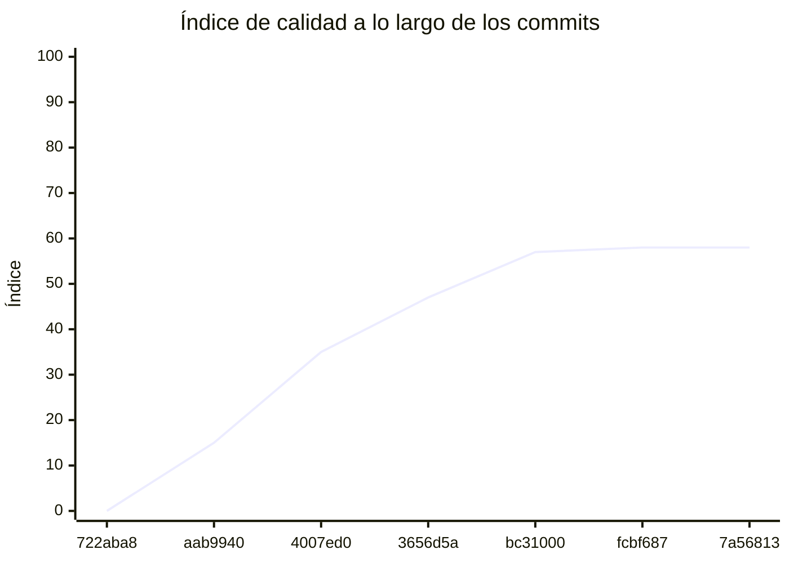

<!-- evaluacion:inicio -->
# Evaluación — prog2-portal-rocio/svc-turnos

> Documento **generado automáticamente** por la cátedra de Programación II (UM): RepoSense + análisis de calidad de **7 dimensiones**. **No editar a mano**: se regenera en cada evaluación.
> Rama evaluada: `main`. Análisis **heurístico** (regex + métricas) + build: es una criba para orientar la revisión, **no una nota**. La **documentación** del repositorio no se evalúa.
> Generado: 2026-11-11.

## 1. Veredicto

| Aspecto | Resultado |
|---|---|
| Índice de calidad | **58/100** |
| Tipo de repositorio | `backend` |
| Build (`mvnw verify` / `gradlew check`) | no compila |
| Código (LOC) | 1,631 |
| Archivos de código | 39 |
| Clases | 41 |
| Código dentro de clases (%POO) | 80% |
| Funciones fuera de clases | 0 |
| Duplicación (puerta) | 10.4% |
| Duplicación lógica | 10.9% |
| Duplicación de boilerplate | 0.0% |

> Este informe **describe** lo que el análisis midió con los criterios ya establecidos de la materia. No es una nota.

## 2. Semáforo de aprobación

Criterios de la cátedra (`CRITERIOS-CALIDAD.md`): **Aprobar** se juega con el perfil `estandar`; **destacar**, con el `exigente` (meta de excelencia).

| Semáforo | Resultado |
|---|---|
| Aprobar (`estandar`) | **no cumple** — 5/11 |
| Destacar (`exigente`) | **no cumple** — 4/11 |

**Para aprobar, falta cumplir:** Duplicación; Tests

**Para destacar, falta cumplir:** SOLID; Duplicación; Tests

## 3. Autoría (RepoSense)

| Autor | Commits | Código (LOC) | Tests (LOC) | Docs (LOC) | Días activos | % del código |
|---|---:|---:|---:|---:|---:|---:|
| Pilar Rocío Portal Romano | 1 | 0 | 0 | 1 | 6 | 0% |

> _El LOC de autoría lo calcula RepoSense sobre el historial y puede diferir del LOC de código del análisis (que mira el estado de `main`)._

## 4. Dimensiones evaluadas

Cada dimensión indica **qué mide**, **por qué importa** y **tu resultado**. Cuando el puntaje queda por debajo de la referencia, se agregan preguntas para **investigar la causa** (no hay recetas).

| Dimensión | Peso | Puntaje |
|:--|--:|--:|
| **D1** Diseño OO, SOLID y patrones (20%) | 20% | 9 |
| **D2** Arquitectura hexagonal — backend (15%) | 15% | 100 |
| **D3** Frontend KMP: MVVM y buenas prácticas (10%) | 10% | N/A |
| **D4** Integración y contrato (10%) | 10% | 40 |
| **D5** Seguridad y robustez (10%) | 10% | 100 |
| **D6** Pruebas y cobertura (20%) | 20% | 30 |
| **D7** Proceso y entrega (15%) | 15% | 100 |

### D1. Diseño OO, SOLID y patrones (20%)

- **Qué mide:** Métricas orientadas a objetos (clases, métodos, campos, cohesión, acoplamiento, herencia) y proxies de SOLID, más patrones de diseño.
- **Por qué importa:** El eje de la materia es el buen uso de la POO y su arquitectura: un diseño con clases claras y poco acopladas es más fácil de entender, probar y cambiar.
- **Tu resultado:** **9/100**
- **Para investigar la causa:**
    - ¿Se pensó el modelo de clases antes de codificar o se agrupó después?
    - ¿Qué clases concentran muchas responsabilidades a la vez?
    - ¿Los colaboradores llegan como parámetros o se crean por dentro?

### D2. Arquitectura hexagonal — backend (15%)

- **Qué mide:** Separación en capas (dominio, puertos de entrada/salida, adaptadores) y dirección de las dependencias del backend.
- **Por qué importa:** Aislar el dominio de la infraestructura permite cambiar la base de datos, el framework o el transporte sin tocar las reglas de negocio.
- **Tu resultado:** **100/100**

### D4. Integración y contrato (10%)

- **Qué mide:** Cumplimiento del contrato de integración de la cátedra (formato de errores, paginación, autenticación, endpoints esperados).
- **Por qué importa:** Los servicios deben poder integrarse entre sí y con la app sin sorpresas; el contrato es lo que hacen cumplir las pruebas de integración.
- **Tu resultado:** **40/100**
- **Para investigar la causa:**
    - ¿Qué endpoints difieren del contrato acordado?
    - ¿Los errores se devuelven con un formato uniforme?
    - ¿La autenticación es consistente entre servicios?

### D5. Seguridad y robustez (10%)

- **Qué mide:** Credenciales embebidas, consultas SQL por concatenación, y presencia de config de entorno; aislamiento de secretos.
- **Por qué importa:** Un secreto en el repositorio o una consulta construida por concatenación son riesgos concretos, no hipotéticos.
- **Tu resultado:** **100/100**

### D6. Pruebas y cobertura (20%)

- **Qué mide:** Cantidad y resultado de pruebas y cobertura de línea (JaCoCo/Kover, Surefire/Failsafe) cuando hay build.
- **Por qué importa:** Las pruebas son la red de seguridad para refactorizar e integrar; la cobertura acota las zonas sin verificar.
- **Tu resultado:** **30/100**
- **Para investigar la causa:**
    - ¿Qué partes del sistema no tienen pruebas?
    - ¿Las pruebas cubren caminos de error o solo el caso feliz?
    - ¿Qué falla al ejecutar la suite completa (no solo la del módulo propio)?

### D7. Proceso y entrega (15%)

- **Qué mide:** Artefactos verificables de proceso/entrega: `compose`, `.env.example`, CI (`.github/workflows/`), `CODEOWNERS` y wrapper de build (`mvnw`/`gradlew`). **No** puntúa documentación.
- **Por qué importa:** Un proyecto que compila, se levanta y se valida solo es más fácil de revisar y de integrar en equipo.
- **Tu resultado:** **100/100**

## 5. Señales detectadas

El análisis encontró las siguientes señales (archivo, sin número de línea a propósito):

**DIP/concretos** (21)
- clase 'JwtTokenAdapter' muy acoplada (CBO=18) — `src/main/java/com/example/svcturnos/usuario/infrastructure/security/JwtTokenAdapter.java`
- clase 'JwtConfig' muy acoplada (CBO=36) — `src/main/java/com/example/svcturnos/usuario/infrastructure/security/JwtConfig.java`
- clase 'JwtConfig' instancia 3 concretos (CBO=36) — `src/main/java/com/example/svcturnos/usuario/infrastructure/security/JwtConfig.java`
- clase 'SecurityConfig' muy acoplada (CBO=10) — `src/main/java/com/example/svcturnos/usuario/infrastructure/security/SecurityConfig.java`
- clase 'UsuarioEntity' muy acoplada (CBO=8) — `src/main/java/com/example/svcturnos/usuario/infrastructure/persistence/entity/UsuarioEntity.java`
- clase 'UsuarioController' muy acoplada (CBO=8) — `src/main/java/com/example/svcturnos/usuario/infrastructure/web/controller/UsuarioController.java`
- clase 'UsuarioExceptionHandler' muy acoplada (CBO=17) — `src/main/java/com/example/svcturnos/usuario/infrastructure/web/handler/UsuarioExceptionHandler.java`
- clase 'RegistrarUsuarioService' muy acoplada (CBO=14) — `src/main/java/com/example/svcturnos/usuario/application/service/RegistrarUsuarioService.java`
- clase 'RegistrarUsuarioService' instancia 6 concretos (CBO=14) — `src/main/java/com/example/svcturnos/usuario/application/service/RegistrarUsuarioService.java`
- clase 'JwtSecurityHttpTest' muy acoplada (CBO=16) — `src/test/java/com/example/svcturnos/usuario/infrastructure/security/JwtSecurityHttpTest.java`
- clase 'JwtSecurityHttpTest' instancia 3 concretos (CBO=16) — `src/test/java/com/example/svcturnos/usuario/infrastructure/security/JwtSecurityHttpTest.java`
- clase 'JwtTestContextInitializer' muy acoplada (CBO=20) — `src/test/java/com/example/svcturnos/usuario/infrastructure/security/JwtTestContextInitializer.java`
- clase 'JwtTestContextInitializer' instancia 3 concretos (CBO=20) — `src/test/java/com/example/svcturnos/usuario/infrastructure/security/JwtTestContextInitializer.java`
- clase 'JwtTokenAdapterTest' muy acoplada (CBO=54) — `src/test/java/com/example/svcturnos/usuario/infrastructure/security/JwtTokenAdapterTest.java`
- clase 'JwtTokenAdapterTest' instancia 20 concretos (CBO=54) — `src/test/java/com/example/svcturnos/usuario/infrastructure/security/JwtTokenAdapterTest.java`
- clase 'JwtConfigTest' muy acoplada (CBO=23) — `src/test/java/com/example/svcturnos/usuario/infrastructure/security/JwtConfigTest.java`
- clase 'JwtConfigTest' instancia 5 concretos (CBO=23) — `src/test/java/com/example/svcturnos/usuario/infrastructure/security/JwtConfigTest.java`
- clase 'AutenticacionControllerTest' muy acoplada (CBO=11) — `src/test/java/com/example/svcturnos/usuario/infrastructure/web/controller/AutenticacionControllerTest.java`
- clase 'UsuarioControllerTest' muy acoplada (CBO=13) — `src/test/java/com/example/svcturnos/usuario/infrastructure/web/controller/UsuarioControllerTest.java`
- clase 'RegistrarUsuarioServiceTest' muy acoplada (CBO=9) — `src/test/java/com/example/svcturnos/usuario/application/service/RegistrarUsuarioServiceTest.java`
- clase 'RegistrarUsuarioServiceTest' instancia 4 concretos (CBO=9) — `src/test/java/com/example/svcturnos/usuario/application/service/RegistrarUsuarioServiceTest.java`

**SRP/responsabilidad** (9)
- método 'SecurityConfig.securityFilterChain' de 36 líneas — `src/main/java/com/example/svcturnos/usuario/infrastructure/security/SecurityConfig.java`
- clase 'UsuarioEntity' grande (LOC=64, métodos=5, campos=11) — `src/main/java/com/example/svcturnos/usuario/infrastructure/persistence/entity/UsuarioEntity.java`
- clase 'UsuarioEntity' con baja cohesión (10%) — `src/main/java/com/example/svcturnos/usuario/infrastructure/persistence/entity/UsuarioEntity.java`
- método 'RegistrarUsuarioService.registrar' de 46 líneas — `src/main/java/com/example/svcturnos/usuario/application/service/RegistrarUsuarioService.java`
- método 'RegistrarUsuarioService.registrar' con complejidad 7 — `src/main/java/com/example/svcturnos/usuario/application/service/RegistrarUsuarioService.java`
- método 'RegistrarUsuarioService.esEmailValido' con complejidad 7 — `src/main/java/com/example/svcturnos/usuario/application/service/RegistrarUsuarioService.java`
- clase 'JwtTestContextInitializer' con baja cohesión (10%) — `src/test/java/com/example/svcturnos/usuario/infrastructure/security/JwtTestContextInitializer.java`
- clase 'JwtTokenAdapterTest' grande (LOC=112, métodos=11, campos=5) — `src/test/java/com/example/svcturnos/usuario/infrastructure/security/JwtTokenAdapterTest.java`
- clase 'JwtTokenAdapterTest' con baja cohesión (15%) — `src/test/java/com/example/svcturnos/usuario/infrastructure/security/JwtTokenAdapterTest.java`

**duplicación** (6)
- duplicación lógica: 10.4% · boilerplate: 0.0%
- bloque de 8 líneas repetido 5 veces en src/test/java/com/example/svcturnos/usuario/infrastructure/security/JwtSecurityHttpTest.java:74, src/test/java/com/example/svcturnos/usuario/infrastructure/persistence/adapter/UsuarioPersistenceAdapterTest.java:22, src/test/java/com/example/svcturnos/usuario/infrastructure/web/controller/AutenticacionControllerTest.java:51 — `src/test/java/com/example/svcturnos/usuario/infrastructure/security/JwtSecurityHttpTest.java`
- bloque de 8 líneas repetido 5 veces en src/test/java/com/example/svcturnos/usuario/infrastructure/security/JwtSecurityHttpTest.java:75, src/test/java/com/example/svcturnos/usuario/infrastructure/persistence/adapter/UsuarioPersistenceAdapterTest.java:23, src/test/java/com/example/svcturnos/usuario/infrastructure/web/controller/AutenticacionControllerTest.java:52 — `src/test/java/com/example/svcturnos/usuario/infrastructure/security/JwtSecurityHttpTest.java`
- bloque de 8 líneas repetido 5 veces en src/test/java/com/example/svcturnos/usuario/infrastructure/security/JwtSecurityHttpTest.java:73, src/test/java/com/example/svcturnos/usuario/infrastructure/web/controller/AutenticacionControllerTest.java:50, src/test/java/com/example/svcturnos/usuario/infrastructure/web/controller/UsuarioControllerTest.java:55 — `src/test/java/com/example/svcturnos/usuario/infrastructure/security/JwtSecurityHttpTest.java`
- bloque de 8 líneas repetido 4 veces en src/test/java/com/example/svcturnos/usuario/infrastructure/security/JwtSecurityHttpTest.java:72, src/test/java/com/example/svcturnos/usuario/infrastructure/web/controller/AutenticacionControllerTest.java:49, src/test/java/com/example/svcturnos/usuario/infrastructure/web/controller/UsuarioControllerTest.java:54 — `src/test/java/com/example/svcturnos/usuario/infrastructure/security/JwtSecurityHttpTest.java`
- bloque de 8 líneas repetido 2 veces en src/test/java/com/example/svcturnos/usuario/application/service/RegistrarUsuarioServiceTest.java:89, src/test/java/com/example/svcturnos/usuario/application/service/RegistrarUsuarioServiceTest.java:109 — `src/test/java/com/example/svcturnos/usuario/application/service/RegistrarUsuarioServiceTest.java`

## 6. Evolución por commit

Métricas calculadas sobre el estado de `main` en **cada commit** (7 commits con trabajo), del primero al último. La calidad usa el perfil `exigente`; el aporte de código lo mide RepoSense. El índice puede **bajar** al crecer el proyecto: se acumulan señales.

| # | Fecha | Commit | Autor | LOC | Índice | %POO | Duplic. | Sueltas |
|---|---|---|---|---:|---:|---:|---:|---:|
| 1 | 2026-09-07 | `722aba8` | Pilar Rocío Portal Romano | 0 | 0 | 0% | 0.0% | 0 |
| 2 | 2026-09-10 | `aab9940` | Ing. Daniel Quinteros | 0 | 15 | 0% | 0.0% | 0 |
| 3 | 2026-10-24 | `4007ed0` | Pilar Rocío Portal Romano | 18 | 35 | 56% | 0.0% | 0 |
| 4 | 2026-10-25 | `3656d5a` | Pilar Rocío Portal Romano | 18 | 47 | 56% | 0.0% | 0 |
| 5 | 2026-11-03 | `bc31000` | Pilar Rocío Portal Romano | 1,342 | 57 | 82% | 14.2% | 0 |
| 6 | 2026-11-08 | `fcbf687` | Pilar Rocío Portal Romano | 1,544 | 58 | 80% | 11.0% | 0 |
| 7 | 2026-11-09 | `7a56813` | Pilar Rocío Portal Romano | 1,631 | 58 | 80% | 10.4% | 0 |

---
_Informe generado por la cátedra. Las dimensiones y umbrales corresponden a `calidad.py` (perfil `exigente`); el semáforo, a `CRITERIOS-CALIDAD.md`. La documentación del repositorio no se evalúa. Ante dudas, revisá el archivo señalado._
<!-- evaluacion:fin -->
