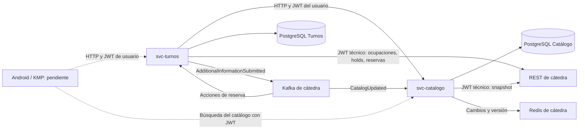

# Arquitectura y límites del sistema

## Alcance

`svc-turnos` administra usuarios y procesos de reserva. No replica el catálogo ni comparte tablas con otro servicio. La cátedra conserva la autoridad sobre holds, vencimientos y reservas definitivas; Turnos registra intenciones, evidencia recibida y resultados locales.

## Vista general

Los dos backends se conectan a la red Docker externa `backends-integracion`. Cada PostgreSQL pertenece únicamente a la red privada de su Compose. Redis y Kafka son integraciones externas, no contenedores definidos por el Compose de Turnos.

El cliente Android/KMP forma parte de la arquitectura prevista, pero su implementación queda fuera del alcance de esta entrega. Las conexiones punteadas representan las integraciones previstas, no funcionalidades móviles verificadas.

## Organización hexagonal

Raíz: [src/main/java/com/example/svcturnos](../src/main/java/com/example/svcturnos). Los módulos son `usuario`, `catalogo`, `disponibilidad`, `reserva` y `shared`.

- **Dominio:** modelos, invariantes y puertos en `domain/model` y `domain/ports/in|out`. No depende de HTTP, Kafka, JPA ni Spring Security.
- **Aplicación:** servicios que implementan casos de uso, coordinan puertos, transacciones locales y recuperación. Utilizan Spring para inyección y demarcación transaccional; las reglas del dominio permanecen separadas.
- **Infraestructura:** controladores/DTO, autenticación, clientes REST, consumidor/productor Kafka, schedulers, repositorios y mappers. Convierte contratos externos a modelos propios.

| Responsabilidad | Caso de uso o coordinación | Puerto / adaptador principal |
| --- | --- | --- |
| Registro y login | `RegistrarUsuarioService`, `AutenticarUsuarioService` | `UsuarioPersistencePort`, `PasswordHasherPort`, `TokenPort`; persistencia JPA, Argon2id y JWT. |
| Consultar Catálogo | Consumido por disponibilidad | `ConsultarCatalogoPort` / `CatalogoRestClientAdapter`. |
| Disponibilidad | `ConsultarDisponibilidadService` | `ConsultarOcupacionesPort` / `OcupacionesRestClientAdapter`. |
| Crear y confirmar hold | `CrearHoldService`, `ConfirmarHoldService` | Puertos remotos, `ProcesoReservaPersistencePort` y adaptadores REST/JPA. |
| Recibir y aplicar acciones | `RecibirEventoReservaService`, `ProcesarResultadoReservaService` | `InboxReservasPort`, `AplicarResultadoReservaPort`; consumidor Kafka y persistencia JDBC. |
| Enviar teléfono | `EnviarInformacionService`, `PublicarInformacionService` | `OutboxInformacionPort`, `PublicarInformacionPort`; outbox JDBC y productor Kafka. |
| Consultar y cancelar reservas | `ConsultarReservasService`, `CancelarReservaService` | Consultas/cancelación remotas y registro local de cancelaciones. |
| Recuperar progreso | `RecuperarConfirmacionService`, `RecuperarResultadosReservaService` | Inbox existente; activación desde correlación/confirmación y scheduler de resultados. |

Los nombres y firmas se encuentran en los [puertos de reserva](../src/main/java/com/example/svcturnos/reserva/domain/ports) y [servicios de aplicación](../src/main/java/com/example/svcturnos/reserva/application/service). Los usuarios y procesos utilizan JPA; inbox, outbox y cancelaciones utilizan JDBC. Los DTO HTTP y Kafka no son entidades persistidas.

## Propiedad de datos y sincronización de Catálogo

Catálogo es propietario de categorías, profesionales, horarios semanales, versión aplicada y diagnóstico de sincronización. Turnos conserva referencias externas y consulta esos datos mediante REST; no comparte tablas ni accede a Redis o al snapshot.

La sincronización completa obtiene un snapshot REST autenticado y persiste datos y versión atómicamente. La incremental aplica cambios Redis en orden y recurre al snapshot cuando falta continuidad. Las notificaciones `CatalogUpdated` activan la sincronización; la reconciliación al arrancar recupera el atraso aun sin una nueva notificación. Un fallo conserva el último catálogo válido y queda reflejado en el diagnóstico del intento.

## Decisiones de consistencia

- No hay transacción distribuida PostgreSQL–REST–Kafka. Las intenciones se confirman localmente antes del efecto externo; las respuestas ambiguas se conservan como tales.
- No se mantienen transacciones PostgreSQL abiertas durante llamadas REST de creación, confirmación o cancelación.
- El control optimista de procesos se complementa con bloqueos transaccionales específicos para operaciones concurrentes e inbox/outbox.
- La inbox registra evidencia antes de confirmar offsets. La outbox registra la intención antes de publicar. Ninguna de ellas proporciona entrega funcional *exactly once*.
- La disponibilidad es una observación, no una reserva garantizada. Solo la evidencia contractual definitiva permite declarar la reserva confirmada.

Las reglas y límites concretos se especifican en [reservas y recuperación](reservas-y-recuperacion.md).

## Trazabilidad documental: PROJECT_STATEMENT §12

| Exigencia | Documento |
| --- | --- |
| Requisitos, configuración y ejecución reproducible | [README](../README.md) y [operación](seguridad-y-operacion.md). |
| Diagrama Android, dos backends, bases e integraciones | Vista general de este documento; KMP identificado como pendiente. |
| Operaciones, DTO, autenticación y errores entre servicios | [Contratos](contratos.md). |
| Modelos y propiedad de datos | [Datos de Turnos](datos-y-estados.md) y delimitación de Catálogo en este documento; su modelo detallado pertenece a ese repositorio. |
| Sincronización completa e incremental | Sección de Catálogo anterior; implementación detallada mantenida en ese servicio. |
| Idempotencia, mensajes perdidos, duplicados y fuera de orden | [Reservas y recuperación](reservas-y-recuperacion.md). |
| Seguridad, autenticación y autorización | [Seguridad y operación](seguridad-y-operacion.md). |
| Ejecución de pruebas automatizadas | [Pruebas](pruebas.md). |
