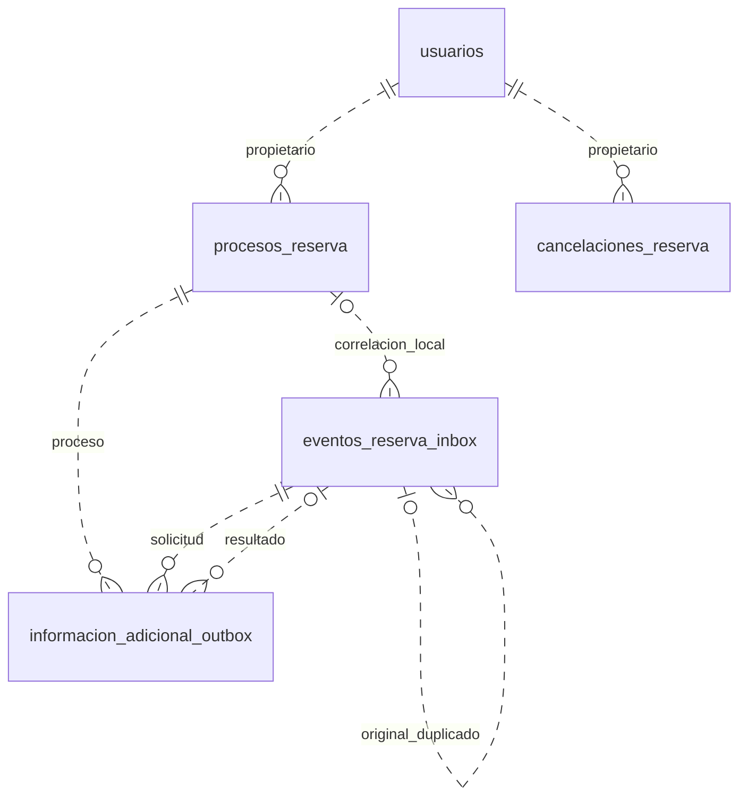
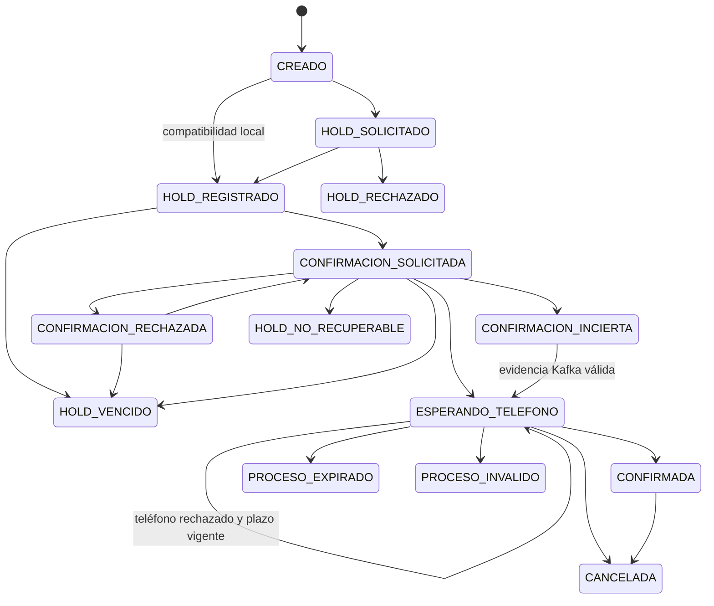

# Modelo persistente y estados

## Propiedad y relaciones

PostgreSQL contiene datos propios de Turnos: usuarios, progreso de reservas, evidencia Kafka e intenciones de publicación/cancelación. No contiene una réplica de profesionales, categorías ni agenda. Los identificadores del catálogo y de cátedra son referencias externas sin FK entre servicios.

Las relaciones son no identificadoras: las FK no forman parte de las PK de las tablas hijas. `proceso_local_id`, `original_id` y `resultado_inbox_id` son opcionales; las FK de propietario, proceso de outbox y solicitud de outbox son obligatorias. V8 permite varias respuestas históricas por solicitud, con una sola habilitada. Una cancelación central legítima puede no tener proceso local: su registro requiere usuario y reserva, no una FK a `procesos_reserva`.

| Tabla | Información y restricciones principales |
| --- | --- |
| `usuarios` | ID local, login/email únicos sin distinguir mayúsculas mediante índices, hash de contraseña, nombre/apellido, idioma, imagen opcional, activación y auditoría. Nombre/apellido admiten hasta 100 caracteres. |
| `procesos_reserva` | ID local, FK al propietario, profesional, fecha/hora, estado, IDs externos de hold/proceso, vencimiento, reserva definitiva, timestamps y versión optimista. `reserva_id` es único cuando existe. El proceso externo tiene índice de búsqueda, no una unicidad que permita asumir correlación inequívoca sin comprobarla. |
| `eventos_reserva_inbox` | Posición Kafka única `(topic,particion,offset_mensaje)`, bytes originales de clave/contenido, JSON decodificado, identidad/tipo/campos del evento, estado, motivo seguro, correlación local y referencia al original cuando es duplicado. Índice único del hash de `eventId` para eventos canónicos; se compara también el identificador completo. |
| `informacion_adicional_outbox` | UUID estable `event_id`, FK al proceso y solicitud de inbox, destino, correlación, teléfono temporal, vencimiento, estado, intentos y concesión de publicación. Solo una respuesta `habilitada` por solicitud, conservando las anteriores como historial. |
| `cancelaciones_reserva` | Proceso externo como PK, usuario propietario, reserva externa única, estado de la operación, timestamps y marca `requiere_reconciliacion`. Permite registrar operaciones sobre reservas sin proceso local. |

La persistencia de usuarios/procesos utiliza JPA y mappers. La inbox, outbox y cancelaciones utilizan adaptadores JDBC con consultas y bloqueos explícitos. Véanse [persistencia de reservas](../src/main/java/com/example/svcturnos/reserva/infrastructure/persistence) y [persistencia de usuarios](../src/main/java/com/example/svcturnos/usuario/infrastructure/persistence).

## Estados del proceso de reserva

Definición normativa local: [EstadoProcesoReserva](../src/main/java/com/example/svcturnos/reserva/domain/model/EstadoProcesoReserva.java). Las invariantes y transiciones están en [ProcesoReserva](../src/main/java/com/example/svcturnos/reserva/domain/model/ProcesoReserva.java); no son equivalencias uno a uno con los estados externos.

| Estado o grupo | Significado |
| --- | --- |
| `CREADO` | Proceso local inicial, todavía sin efecto remoto acreditado. |
| `HOLD_SOLICITADO` | Intención durable previa al POST. Si no se conoce su resultado, no se crea automáticamente otro hold equivalente. |
| `HOLD_RECHAZADO` | Solicitud de hold rechazada de forma conocida; no hay hold registrado. |
| `HOLD_REGISTRADO` | Identificadores y vencimiento del hold remoto conocidos. No es una reserva confirmada. |
| `CONFIRMACION_SOLICITADA` | Intención durable de confirmación inicial. Puede quedar así si falla la persistencia posterior al POST. |
| `CONFIRMACION_INCIERTA` | No se conoce con seguridad el resultado de la confirmación remota. |
| `CONFIRMACION_RECHAZADA` | Último intento de confirmación no aceptado, también por configuración o credencial técnica. No equivale a rechazo definitivo de la reserva. |
| `ESPERANDO_TELEFONO` | Aceptación inicial acreditada. La vigencia se comprueba por separado con el vencimiento; el enum no garantiza que el plazo siga abierto. |
| `HOLD_VENCIDO`, `HOLD_NO_RECUPERABLE` | Cierre local respaldado por la evidencia disponible sobre el hold. |
| `CONFIRMADA` | Confirmación definitiva acreditada y `reserva_id` conservado. |
| `CANCELADA` | Cancelación definitiva acreditada, con identificador de reserva. |
| `PROCESO_EXPIRADO`, `PROCESO_INVALIDO` | Resultado final del proceso según la política y el evento contractual. |

Transiciones principales; el diagrama no reemplaza las comprobaciones de identidad, vigencia y orden temporal del dominio:

Un resultado definitivo también puede llegar antes de persistir un progreso intermedio; la política evalúa la evidencia contractual sin exigir que se hayan observado todos los pasos del diagrama. Una cancelación válida puede preceder a la recepción de la confirmación. No se reabren estados finales mediante eventos antiguos. Una cancelación posterior coherente sí puede suceder a `CONFIRMADA`.

`resultadoOcurridoEn` y las comparaciones de resultados utilizan microsegundos, coherentes con PostgreSQL. El timestamp original del mensaje se mantiene en la inbox. Eventos distintos que quedan en el mismo instante normalizado no se consideran automáticamente posteriores; la política resuelve obsolescencia o necesidad de reconciliación según estado/evidencia.

Un 202 recibido con un plazo ya terminado conserva la aceptación observada, pero la operación informa vencimiento y no habilita el envío de teléfono. El vencimiento conocido no se extiende localmente.

## Estados de mensajería y cancelación

Son máquinas separadas del estado del proceso:

- **Inbox:** `RECIBIDO`, `SOLICITUD_REGISTRADA`, `PENDIENTE_CORRELACION`, `CORRELACION_INCONSISTENTE`, `PENDIENTE_TIPO`, `INVALIDO`, `DUPLICADO`, `EVENT_ID_EN_CONFLICTO`, `RESULTADO_APLICADO`, `RESULTADO_OBSOLETO`, `REQUIERE_RECONCILIACION`.
- **Outbox:** `PENDIENTE`, `PUBLICANDO`, `INCIERTA`, `ENVIADA`, `VENCIDA`. `ENVIADA` acredita el acuse del broker, no el resultado de la reserva. Solo `PUBLICANDO` admite `intento_id` y `concesion_hasta`, ambos informados; en los demás estados ambos son nulos.
- **Cancelación:** `SOLICITADA`, `INCIERTA`, `RECHAZADA`, `CANCELADA`. El indicador de reconciliación conserva discrepancias locales aun cuando la cancelación remota esté acreditada.

## Transacciones y concurrencia

`version` evita pérdidas de actualizaciones de procesos. Los adaptadores complementan este control mediante bloqueos de filas y advisory locks transaccionales. La exclusión de holds equivalentes considera usuario, profesional, fecha y hora; no existe una restricción permanente que impida reservar ese horario en el futuro tras un rechazo o vencimiento seguro.

La aplicación de resultados actualiza proceso, tratamiento de outbox y estado de inbox en una transacción. Un fallo revierte el conjunto, dejando evidencia pendiente recuperable. El registro previo al POST y el registro posterior a su respuesta son transacciones separadas; un rollback local no deshace una operación externa.

## Migraciones Flyway

Fuente: [src/main/resources/db/migration](../src/main/resources/db/migration). Flyway se ejecuta al arrancar y Hibernate utiliza `ddl-auto=none`.

| Versión | Alcance |
| --- | --- |
| V1 | Usuarios e índices de identidad. |
| V2 | Procesos, propietario, datos de progreso y versión optimista. |
| V3 | Estados de solicitud y rechazo de hold. |
| V4 | Índice para holds equivalentes por propietario/profesional/fecha/hora. |
| V5 | Inbox Kafka, posiciones e idempotencia funcional. |
| V6 | Confirmación inicial y estados asociados. |
| V7 | Outbox de información adicional y concesiones de publicación. |
| V8 | Resultados finales, reserva definitiva, timestamp del resultado y respuestas históricas de teléfono. |
| V9 | Intenciones/resultados de cancelación. |
| V10 | Ampliación de nombre y apellido de usuario a 100 caracteres. |

Las migraciones aplicadas no deben editarse. V10 no corrige datos personales previos: usuarios con nombres incompatibles con el contrato pueden autenticarse, pero la confirmación se rechaza de forma controlada antes del POST externo. Las validaciones nuevas de registro evitan generar esos casos.
