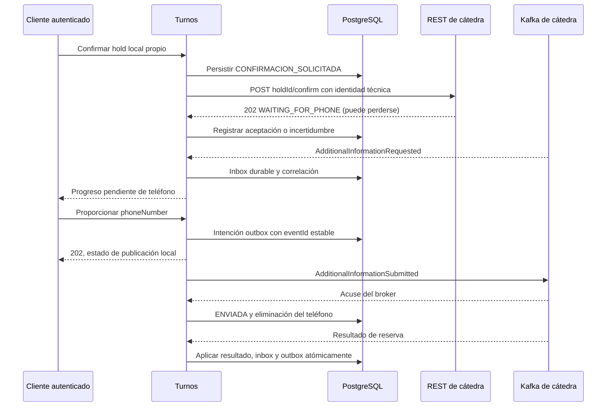

# Reservas, mensajería y recuperación

Los [contratos HTTP](contratos.md) y [estados persistidos](datos-y-estados.md) se mantienen en sus documentos específicos.

## Disponibilidad y creación del hold

1. `ConsultarDisponibilidadService` obtiene profesional y categoría mediante `ConsultarCatalogoPort`. Si alguno está deshabilitado, devuelve lista vacía.
2. `AgendaDiaria` utiliza los horarios habilitados del día consultado. Genera bloques completos desde el inicio de cada jornada, con la duración configurada, sin superar el cierre. Admite varias jornadas y elimina bloques idénticos; rechaza intervalos que crucen medianoche o tengan duración inválida.
3. Sin candidatos no se consultan ocupaciones. Con candidatos, `ConsultarOcupacionesPort` obtiene la fecha inclusiva consultada para ese profesional.
4. `DisponibilidadDiaria` excluye candidatos cuya **fecha y hora de inicio** coinciden con una ocupación `CONFIRMED` o `HELD` con vencimiento estrictamente posterior al `Clock` actual. Conserva el orden de los candidatos generado por `AgendaDiaria`.
5. El contrato de ocupaciones no proporciona hora final ni duración. No se calculan solapamientos parciales ni se presume una duración. Un fallo externo no se convierte en lista vacía ni disponibilidad total.

`CrearHoldService` identifica al usuario activo y comprueba disponibilidad. La persistencia serializa la creación de intenciones equivalentes por usuario/profesional/fecha/hora, evitando la carrera entre consulta y guardado. Se registra `HOLD_SOLICITADO` **antes** del POST remoto y se finaliza esa transacción local antes de realizar HTTP.

Un 201 válido registra `holdId`, proceso externo y vencimiento real. Un rechazo conocido permite conservar el historial rechazado; un resultado perdido conserva la incertidumbre y bloquea otro intento equivalente. Un hold conocido vencido puede permitir una nueva operación, según el estado. No se elimina el proceso anterior ni se repite automáticamente el POST.

## Confirmación inicial y teléfono

La solicitud Kafka puede llegar antes, durante o después del registro REST. El diagrama muestra una secuencia posible, no un orden obligatorio entre HTTP y Kafka.

`ConfirmarHoldService` valida propiedad, datos del paciente persistido y plazo con `Clock`. Una aceptación 202 no significa `CONFIRMADA`. Se valida proceso externo, estado y vencimiento; no se extiende el plazo conocido. Un fallo puramente técnico previo o un rechazo conocido no se confunden con aceptación remota; un resultado ambiguo permanece incierto. No se mantiene una transacción PostgreSQL abierta durante HTTP.

## Topics y esquemas Kafka

Los nombres concretos y consumer group se configuran con los datos asignados por la integración técnica. Para reservas, la clave Kafka es `reservationProcessId`; `schemaVersion` es 1 y se toleran campos adicionales compatibles. Referencia exacta: `INTEGRATION_REFERENCE` §§15.1–15.10.

| Dirección | Topic contractual | Evento |
| --- | --- | --- |
| Entrada | `alumnos.turnos.acciones.{groupId}` | Solicitudes y cinco resultados indicados debajo. |
| Salida | `catedra.turnos.telefono.{groupId}` | `AdditionalInformationSubmitted`. |

`AdditionalInformationRequested` contiene `eventId`, `eventType`, `reservationProcessId`, `holdId`, `requiredField=PHONE_NUMBER`, `message`, `expiresAt`, `occurredAt`, `schemaVersion`. Su `eventId` se conserva como **`requestEventId`**, no se reemplaza por el del envío.

`AdditionalInformationSubmitted` contiene `eventId`, `eventType`, `groupId`, `reservationProcessId`, `holdId`, `requestEventId`, `information.phoneNumber`, `occurredAt`, `schemaVersion`. La identidad del paciente y la correlación no proceden del cuerpo HTTP arbitrario. La información sensible no se incluye en logs.

Los cinco resultados incluyen la envoltura de identidad/correlación contractual: `eventId`, `eventType`, `groupId`, `reservationProcessId`, `holdId`, `requestEventId`, `occurredAt`, `schemaVersion`. El mapper exige la referencia a la solicitud original según `INTEGRATION_REFERENCE-v2` §§15.6–15.10 (v2 es la versión del documento; los mensajes mantienen `schemaVersion: 1`); no se utiliza como referencia al último envío de teléfono.

| Resultado | Datos específicos y efecto |
| --- | --- |
| `AppointmentConfirmed` | `reservationId`, `professionalId`, `date`, `startTime`, `status=CONFIRMED`. Acredita reserva definitiva y conserva su ID. |
| `AdditionalInformationRejected` | `reason`, `message`, `expiresAt`. Permite otra respuesta mientras sea válida; no rechaza definitivamente la reserva. |
| `AppointmentProcessExpired` | `reason`. Cierra el proceso sin reabrirlo por mensajes antiguos. |
| `AppointmentProcessInvalid` | `reason`. La política aplica cierre o conserva necesidad de reconciliación si la evidencia es contradictoria. |
| `AppointmentCancelled` | `reservationId`, `professionalId`, `date`, `startTime`, `status=CANCELLED`, `reason` cuando se informa. Acredita cancelación; puede seguir legítimamente a una confirmación. |

La validación de campos específicos está en [ResultadoReservaJsonMapper](../src/main/java/com/example/svcturnos/reserva/infrastructure/kafka/ResultadoReservaJsonMapper.java) y la política en [PoliticaResultadosReserva](../src/main/java/com/example/svcturnos/reserva/domain/model/PoliticaResultadosReserva.java).

## Inbox y aplicación de resultados

El consumidor existente recibe bytes, decodifica y delega en `RecibirEventoReservaService`. Primero conserva posición Kafka, bytes originales y diagnóstico. Los mensajes malformados, inválidos, desconocidos o no correlacionables no se descartan: permanecen con su estado correspondiente.

La posición Kafka evita duplicar el registro de una misma entrega; una reentrega puede reintentar su correlación pendiente. `eventId` identifica funcionalmente el evento a través de posiciones distintas y reinicios. La persistencia distingue evento canónico, duplicado y conflicto de identidad/payload. Un duplicado no vuelve a aplicar una transición.

El consumidor confirma el offset cuando `RecibirEventoReservaService.recibir()` retorna sin excepción, después de conservar la recepción y ejecutar la correlación/procesamiento inmediato que corresponda. Puede retornar con un estado pendiente, inválido o para revisión: confirmar el offset acredita conservación durable, no aplicación definitiva al proceso. Si falla la persistencia o la correlación y la excepción se propaga al listener, no se ejecuta `acknowledge()` y el error handler detiene el contenedor consumidor. Lo ya conservado permanece recuperable desde la inbox, sin depender exclusivamente de la reentrega Kafka.

La correlación verifica proceso externo, hold y proceso local único. Para resultados también comprueba grupo, solicitud original y, cuando están presentes, reserva/profesional/fecha/hora. No se aplica evidencia a una asociación contradictoria. `AplicarResultadoReservaPersistenceAdapter` bloquea y relee el proceso y el registro de inbox, y actualiza proceso, outbox e inbox en una transacción.

`PoliticaResultadosReserva` protege estados finales y compara tiempos a precisión de microsegundos. Un evento anterior puede quedar obsoleto; uno contradictorio queda para reconciliación. No se fuerza un estado para vaciar la inbox. La confirmación tardía no revierte una cancelación ya acreditada.

## Activación de consumo y publicación

`KAFKA_LISTENER_AUTO_STARTUP` alimenta `turnos.kafka.enabled`: en `true` crea el consumidor, su configuración de errores y `ResultadosReservaScheduler`, además de habilitar el arranque del listener mediante `spring.kafka.listener.auto-startup`. El scheduler recupera resultados de PostgreSQL; no necesita que Kafka vuelva a entregar cada mensaje.

`KAFKA_PHONE_PUBLICATION_ENABLED` alimenta `turnos.kafka.phone-publication-enabled` de forma independiente: habilita la aceptación de teléfono en `EnviarInformacionService` y crea `OutboxInformacionScheduler`, que publica y depura vencidos. `InformacionKafkaProducerAdapter` no tiene esa condición de creación; el flag controla este flujo automático y la aceptación HTTP, no la existencia del bean productor. Ambos flags son `false` por defecto.

## Outbox y reintentos

`EnviarInformacionService` valida propietario, estado, solicitud canónica correlacionada, campo solicitado y vencimiento. La transacción registra una única respuesta habilitada por solicitud. Dos peticiones simultáneas no crean dos intenciones lógicas.

El scheduler obtiene lotes de hasta 10 publicaciones mediante concesiones y bloqueos `SKIP LOCKED`. La concesión dura 60 segundos; la demora predeterminada entre el fin de un ciclo y el siguiente es de 5 segundos y la demora de reintento, 10 segundos. Hay un máximo de 5 intentos de aplicación. PostgreSQL no queda bloqueado durante el envío Kafka.

`InformacionKafkaProducerAdapter` espera el acuse del broker antes de registrar `ENVIADA`. Un timeout deja `INCIERTA`; la recuperación conserva **el mismo `eventId`**, aunque el broker pudiera haber recibido el intento anterior. Los reintentos del productor y su idempotencia no equivalen a *exactly once* entre PostgreSQL, broker y cátedra.

El teléfono se elimina al acreditar el envío, vencer/depurar la publicación o aplicar un resultado que la deshabilita. Agotar intentos no equivale a entrega: conserva incertidumbre y puede conservar el teléfono hasta la depuración por vencimiento. La depuración periódica pertenece al publicador habilitado. No existe una política general de retención/purga de la inbox.

Un rechazo válido deshabilita la respuesta previa, conservando historial, y permite otra respuesta con **nuevo `eventId`** y el mismo `requestEventId` mientras el plazo siga vigente. Una repetición incompatible, o posterior a eliminar el teléfono que permitiría comparar el contenido, devuelve conflicto y no genera otra publicación.

## Recuperación después de fallos o reinicios

### Confirmación inicial incierta

`RecuperarConfirmacionService` permite continuar desde `CONFIRMACION_SOLICITADA` o `CONFIRMACION_INCIERTA` cuando existe una solicitud Kafka canónica, válida, persistida y correlacionada inequívocamente con el mismo proceso local, proceso externo y hold. Verifica vigencia sin ampliar vencimientos. No declara confirmación definitiva ni repite el POST REST.

La recuperación se integra con la correlación de solicitudes y con la operación de confirmación local. Ante concurrencia optimista relee el proceso; no sobrescribe un resultado definitivo. Sin evidencia suficiente conserva incertidumbre.

### Solicitudes pendientes dirigidas al proceso

`ConfirmarHoldService` utiliza la consulta de inbox por proceso externo y hold, no los primeros 1.000 pendientes globales. La búsqueda avanza por ID con páginas de 100 y un límite superior fijado al iniciar el recorrido. No carga toda la inbox en memoria ni pierde posiciones al cambiar el estado de registros ya visitados.

Se correlacionan las solicitudes compatibles recibidas antes o durante la operación. Las posteriores conservan el camino normal del consumidor o una recuperación posterior. Este recorrido dirigido no es un barrido periódico general de todas las solicitudes.

### Resultados finales pendientes

`ResultadosReservaScheduler`, activo con `turnos.kafka.enabled=true`, tiene demora inicial 0 y demora fija de 5 segundos después de terminar cada ejecución, por defecto. `RecuperarResultadosReservaService` busca eventos canónicos de los cinco tipos finales en `RECIBIDO`, `PENDIENTE_CORRELACION`, `PENDIENTE_TIPO` o `REQUIERE_RECONCILIACION`.

El ciclo fija un ID superior y procesa hasta 100 registros por ejecución con cursor, evitando que mensajes nuevos posterguen indefinidamente los anteriores. Cada evento tiene su propia transacción. Un fallo individual no elimina el evento ni impide dar oportunidad a los demás. Al completar el recorrido se inicia otro; tras reiniciar, el cursor en memoria vuelve al inicio y la evidencia durable permanece.

Reevaluar un evento no relaja sus validaciones. Los eventos inválidos o con correlación inconsistente no se aplican automáticamente; una discrepancia contractual puede requerir diagnóstico y evidencia adicional. No existe una reconciliación REST general de todos los estados inciertos.

## Consulta y cancelación

Las consultas locales no dependen de Catálogo. Las reservas centrales se consultan para el paciente derivado del usuario, admitiendo reservas legítimas sin proceso local y sin inventar una asociación. Consultar no reescribe el estado local.

Antes de cancelar, `CancelarReservaService` verifica propiedad central y coherencia con cualquier asociación local. Recorre los estados centrales con páginas acotadas; si se alcanza el límite de búsqueda de 1.000 por estado sin completar la verificación, falla de forma controlada y **no envía el POST**.

Se registra la intención de cancelación antes del HTTP. El 200 central `CANCELLED` es definitivo; el evento Kafka posterior converge idempotentemente. Una respuesta perdida permanece incierta y no provoca otro POST automático. Una consulta posterior que acredita cancelación puede recuperar la operación. Contradicciones con un estado local definitivo conservan el resultado remoto y `requiereReconciliacion`, sin sobrescribirlo arbitrariamente.

## Límites contractuales

- Perder la respuesta de creación de hold puede dejar una intención sin identificadores externos. No se inventa una consulta de hold que el contrato no ofrece.
- Una confirmación incierta solo se recupera con evidencia correlacionable suficiente; no por el mero transcurso del tiempo.
- La disponibilidad no detecta solapamientos parciales sin duración externa, ni garantiza que el bloque siga libre al crear el hold.
- Las contradicciones definitivas, mensajes inválidos y búsquedas centrales incompletas se conservan o rechazan de forma observable; no se resuelven mediante efectos remotos ciegos.
